# Del microdato al modelo: determinantes del ingreso laboral en México, 2018–2024

**Documento para revisión con asesora.** Recorrido metodológico, problemas encontrados, soluciones adoptadas y lectura del modelo final.
**Estado:** notebooks 14, 15 y 16 ejecutados de principio a fin el 18 y el 20-10-2026; resultados pendientes de revisión.
**Fuentes de cada cifra:**
- `notebooks/15_especificacion_validacion_fuera_muestra.ipynb`: especificación y validación;
- `notebooks/16_interpretacion_modelo_final.ipynb`: interpretación;
- tablas en `outputs/especificacion_validacion_fuera_muestra/` y `outputs/interpretacion_modelo_final/`.

---

## En una página

**Pregunta.** ¿Qué características individuales, educativas, laborales, del hogar y territoriales se asocian con el ingreso laboral en México, cómo varían entre regiones y tamaños de localidad, y cómo cambiaron entre 2018 y 2024?

**Datos.** ENIGH 2018, 2020, 2022 y 2024, con 1.2 millones de personas en total. La unidad de análisis es la persona de 18 años o más con ingreso laboral o de negocio positivo: entre 120 mil y 142 mil por año. Los cuatro levantamientos son cortes transversales, no un panel.

**Modelo final.** Regresión lineal sobre $\ln(1+\text{ingreso trimestral})$, estimada por año, con errores agrupados por hogar. Incluye:
- forma funcional no lineal en edad y horas;
- escolaridad homologada;
- variables laborales, del hogar y territoriales;
- ocupación y sector;
- cinco bloques de interacciones seleccionados con una regla fija.

Explica **52%–55% de la varianza fuera de muestra**; el punto de partida explicaba 43%–45%.

**Cinco hallazgos:**

1. **La prima educativa se comprimió con fuerza.** La asociación total de una licenciatura concluida frente a secundaria concluida pasó de **+65% en 2018 a +43% en 2024**, y la del posgrado de +172% a +110%. Ambos cambios son significativos con corrección por comparaciones múltiples.
2. **La brecha de género es grande y se redujo poco.** En promedio las mujeres reciben **28%–31% menos** que hombres comparables. La brecha es mayor en localidades rurales (−32% a −39%) que en ciudades grandes (−18% a −27%).
3. **El territorio pesa, y la geografía de la ventaja cambió.** Con todo lo demás controlado, el Norte pasó de +10% a **+20%** frente al Centro y el Sur redujo su desventaja de −15% a **−8%**. Entre entidades, Baja California está +39% y Guerrero −27% frente a Ciudad de México (2024).
4. **El mercado laboral está segmentado.** Hay grandes diferencias por tamaño de empresa: trabajar solo está asociado con −26% y una empresa de 251 o más personas con +27% frente a una de 2 a 5. La seguridad social se asocia con +16%, el contrato con +17%, y la relación entre horas e ingreso es distinta para asalariados e independientes.
5. **Lo que separaba a los grupos se achicó entre 2018 y 2024.** Bajan las primas de escolaridad, de ocupación directiva, de estrato socioeconómico alto y del sector gobierno; se cierra la brecha del Sur. Es un patrón de **compresión** de los diferenciales de ingreso. Coincide en el tiempo con los fuertes aumentos del salario mínimo desde 2019; es una hipótesis para discutir, porque el modelo no identifica causas.

Todas son **asociaciones condicionadas**, no efectos causales.

---

## 1. El recorrido

| Etapa | Notebooks | Qué se logró | Qué quedó como decisión |
| --- | --- | --- | --- |
| Datos y estructura | 01–05 | Revisión de las tablas ENIGH, decodificación de 263 variables categóricas, geografía (entidad, municipio, región Banxico) y dos bases analíticas validadas: personas (1,203,231) y hogares (345,169) | No unir tablas 1:N sin agregar primero |
| Exploración | 06–09 | Brechas descriptivas por región, localidad, estrato y sexo; Gini con ponderadores; calidad de faltantes y ceros | Separar desigualdad de determinantes |
| Intentos acotados | 10–11 | Deflactor común por año y diseño muestral formal (JKn) | Ambos fuera del alcance principal; conservados como intentos históricos |
| Base de determinantes | 12 | Base de personas por año con ingreso positivo y validaciones de comparabilidad | Corrección auditable de etiquetas contaminadas |
| Diagnóstico 2024 | 13 | Regresión diagnóstica, VIF, PCA y árbol en 2024 | No trasladar selecciones de 2024 a otros años |
| Comparación temporal | 14 | Modelo común por año, *pooled* e interacciones con año; escolaridad homologada | Escala log nominal; errores agrupados por hogar |
| Especificación y validación | 15 | Forma funcional, variables antes excluidas, ocupación y sector, interacciones, geografía, Huber, cuantílica, Duan; validación cruzada | Modelo final M5 y regla de selección |
| Interpretación | 16 | Efectos promedio, perfiles y cambios 2018–2024 del modelo final | Este documento |

---

## 2. Problemas que encontramos y cómo los resolvimos

Cada problema se describe con su síntoma, por qué importa, qué se hizo y con qué evidencia.

### 2.1 La estructura de la ENIGH duplica personas si se une sin cuidado

*Síntoma.* `trabajos` e `ingresos` tienen varias filas por persona (relación 1:N).
*Por qué importa.* Un *merge* directo multiplica personas y montos.
*Solución.* Se agregan trabajos e ingresos a nivel persona antes de unir, y cada unión valida cardinalidad (`validate="m:1"`) y duplicados de llave (notebooks 04–05). Hay cero duplicados en todas las llaves.

### 2.2 Etiquetas contaminadas y catálogos que cambian entre años

*Síntoma.* Algunas etiquetas vienen corruptas en los archivos fuente:
- Seguridad social, código 2, en 2020 y 2022: *"No nóicpircseD .0202 y"*.
- Estado conyugal, etnia y parentesco en 2024 (por ejemplo, *"Está soltera(o) nóicpircseD .4202 y"*).

Además, varios catálogos cambian entre años:
- en 2024 el código 08 de escolaridad pasó a ser *Especialidad* y desplazó Maestría y Doctorado;
- la ocupación cambia de SINCO 2011 a SINCO 2019;
- el sector cambia de SCIAN 2013 a SCIAN 2018.

*Por qué importa.* Comparar por etiqueta crearía categorías falsas o mezclaría niveles distintos entre años.
*Solución.* Homologación **por código**, con verificación de que cada código tenga la etiqueta esperada; la ejecución se detiene ante un código no catalogado. Ocupación y sector se usan en niveles estables entre versiones: nueve divisiones SINCO y once sectores SCIAN amplios. La escolaridad se agrupa en ocho niveles homologados, con Especialidad, Maestría y Doctorado dentro de Posgrado.

### 2.3 Faltantes que no son faltantes

*Síntoma.* El 3.7% de las personas con ingreso laboral no reporta trabajo principal (0 horas, 0 trabajos), y el contrato solo existe para trabajadores subordinados con pago.
*Por qué importa.* Imputarlos inventaría información; descartarlos sesgaría la muestra.
*Solución.* Se crean categorías explícitas *No aplica*. Se verificó que "sin trabajo principal" coincide **exactamente** con 0 horas y 0 trabajos. Las columnas que resultan idénticas entre variables, por ejemplo "tamaño de empresa: no aplica" y "subordinación: no aplica", se eliminan con una factorización QR que deja registro.

### 2.4 ¿Pesos de 2024 o pesos nominales?

*Síntoma.* El único deflactor disponible se calibró con el ingreso del **hogar**; su uso para el ingreso laboral **individual** no está aprobado (etapa 10).
*Solución.* Se conserva el ingreso **nominal**. Las comparaciones entre años se hacen en brechas porcentuales, que no dependen del nivel de precios: si todos los ingresos de un año se multiplican por un factor $k$, la diferencia $\ln(ky_1) - \ln(ky_2)$ no cambia. Los niveles en pesos no se comparan entre años.

### 2.5 Inferencia con una encuesta compleja

*Síntoma.* La ENIGH tiene estratos, unidades primarias de muestreo y ponderadores; la réplica formal del diseño (JKn, etapa 11) quedó fuera de alcance.
*Solución.* Se usan errores estándar **agrupados por hogar**, porque los miembros de un hogar comparten choques. La validación cruzada también se agrupa por hogar, para que ningún hogar quede repartido entre entrenamiento y prueba.
*Limitación.* No reproduce el diseño completo y las estimaciones no están ponderadas.

### 2.6 Un notebook "preparado sin ejecutar" que sí estaba ejecutado

*Síntoma.* El README y el contrato decían que el notebook 14 no se había ejecutado, aunque ya tenía resultados; además, varias celdas estaban editadas después de correr.
*Solución.* Se re-ejecutó completo. Los resultados fueron **idénticos byte a byte** a la corrida previa, y se corrigió la documentación. Es la prueba de reproducibilidad del flujo.

### 2.7 El ajuste estaba estancado en $R^2 \approx 0.44$

*Diagnóstico.* La edad y las horas entraban de forma lineal, aunque la relación con el ingreso es claramente curva:

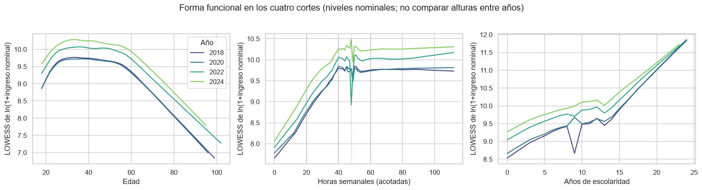

- **Edad:** el ingreso sube hasta alrededor de los 40 años y baja después, el perfil cóncavo que predice la teoría del capital humano (Mincer).
- **Horas:** el ingreso trimestral crece hasta unas 48 horas y se aplana después.

Además, el modelo omitía variables disponibles: ocupación y sector (que hubo que recuperar de `trabajos.csv` modificando los notebooks 05 y 12), estado conyugal, parentesco, tamaño de empresa, estrato y otras.

*Solución.* Una **escalera de especificaciones** evaluada con $\bar R^2$, AIC, BIC y $R^2$ de validación cruzada por hogar:

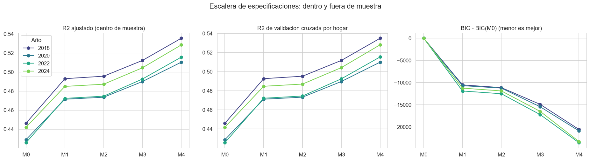

| $R^2$ fuera de muestra | 2018 | 2020 | 2022 | 2024 |
| --- | --- | --- | --- | --- |
| M0: modelo del notebook 14 | 0.446 | 0.429 | 0.426 | 0.442 |
| M1: + edad cuadrática y *spline* de horas | 0.493 | 0.471 | 0.472 | 0.485 |
| M3: + variables antes excluidas | 0.512 | 0.490 | 0.492 | 0.504 |
| M4: + ocupación y sector | 0.535 | 0.510 | 0.515 | 0.528 |
| **M5: + interacciones (final)** | **0.545** | **0.518** | **0.524** | **0.536** |

La mayor ganancia viene de la forma funcional. El $R^2$ dentro y fuera de muestra difiere en menos de 0.001: **no hay sobreajuste**.

### 2.8 Un valor extremo: 17 millones de pesos en un trimestre

*Síntoma.* En 2024 una persona reporta 17.0 millones trimestrales, 2.8 veces el siguiente valor.
*La tentación.* Recortar colas por grupo para "estabilizar la varianza".
*Por qué no.* Eliminar observaciones según el valor de la variable dependiente **trunca** la muestra y sesga los coeficientes hacia cero. Sube el $R^2$ artificialmente porque quita justo lo que el modelo no explica.
*Solución.* Una regla de plausibilidad única y documentada: se excluye un registro si su log-ingreso está a más de **8 desviaciones robustas** (mediana y MAD) por encima de la mediana del año. Solo excluye ese caso.

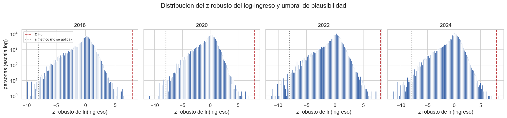

*Transparencia.* El umbral se fijó tras ver el caso, y su perfil es económicamente posible: empleador de 62 años con licenciatura, en una empresa de 11 a 50 personas. Su influencia en el modelo en log es despreciable ($R^2$ de 0.44207 a 0.44213); en el modelo en pesos es la observación más influyente ($R^2$ de 0.070 a 0.136). Los extremos restantes se tratan con estimadores robustos (Huber) y cuantílicos, no borrándolos.

### 2.9 Los años de escolaridad "rompían" la prima educativa

*Síntoma.* Al agregar los años totales de escolaridad junto con los niveles educativos, la licenciatura salía con prima **negativa** en 2024 y el GVIF de los años era de 21.
*Diagnóstico.* Los años totales son casi una función del nivel, y con ambos en el modelo los niveles solo miden desviaciones de una recta.
*Solución.* Se usan **grados aprobados respecto al grado típico de conclusión del nivel**. Así los niveles conservan su lectura de prima al concluir el nivel, y el nuevo término mide cada grado adicional dentro del nivel (+2.4% a +2.9%). El GVIF baja a 1.1.

### 2.10 ¿Es correcto usar logaritmo?

*Pregunta.* ¿Por qué transformar el ingreso con logaritmo y no con otra función?
*Evidencia.* La familia Box–Cox, $y^{(\lambda)} = (y^\lambda - 1)/\lambda$, condicionada a los regresores:

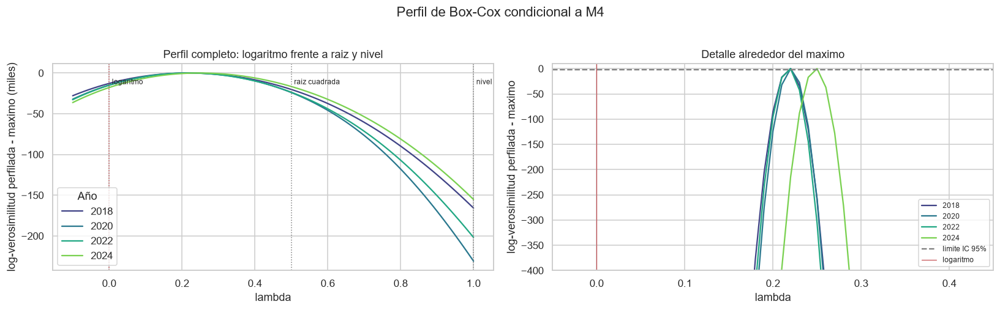

| | 2018 | 2020 | 2022 | 2024 |
| --- | --- | --- | --- | --- |
| $\hat\lambda$ óptimo | 0.22 | 0.22 | 0.22 | 0.25 |
| Pérdida de log-verosimilitud del logaritmo | 12,789 | 14,864 | 14,952 | 17,831 |
| Pérdida de la raíz cuadrada | 20,196 | 23,958 | 23,601 | 16,574 |
| Pérdida del nivel (sin transformar) | 165,789 | 230,935 | 201,822 | 155,260 |
| Ganancia de transformar que captura el log | 92% | 94% | 93% | 89% |
| Asimetría de residuos: log / $\hat\lambda$ / raíz / nivel | −0.82 / 0.46 / 4.5 / 48 | −0.80 / 0.49 / 6.0 / 121 | −0.82 / 0.59 / 5.2 / 68 | −0.91 / 0.60 / 3.7 / 50 |

*Lectura.* El ingreso en niveles es inadecuado: la pérdida es enorme y la asimetría residual llega a 50–120. Los datos piden una transformación muy compresiva. El logaritmo **no es exactamente óptimo**, pero recupera alrededor del 90% de la ganancia de transformar. Entre las escalas con interpretación es la que deja residuos menos asimétricos, y es la única cuyos coeficientes se leen como diferencias porcentuales y comparables entre años. El costo, una asimetría negativa por los ingresos muy bajos, se atiende con la regresión cuantílica y la corrección de Duan.

### 2.11 La varianza no es la misma para todos

*Síntoma.* La dispersión del ingreso de los **independientes** (desviación residual de 1.17 a 1.27) casi duplica la de los **asalariados** (0.60 a 0.70). También difiere por región y tamaño de localidad; la prueba de Breusch–Pagan da p ≈ 0.

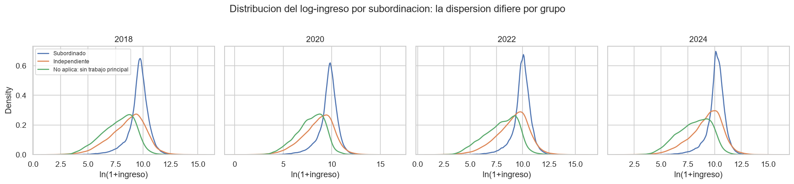

*Lo que no resuelve.* "Estabilizar la varianza" **no sube el $R^2$**: la heterocedasticidad afecta la precisión, no los coeficientes. FGLS por estrato redujo los errores estándar de la mayoría de los coeficientes en 15%–20%, sin mejorar el ajuste.
*Lo que sí funcionó:*
- errores estándar agrupados por hogar;
- **ecuaciones separadas** para asalariados e independientes, que mejoran el $R^2$ fuera de muestra en los cuatro años (por ejemplo, independientes de 0.496 a 0.517 en 2024);
- la corrección de Duan por grupo (2.15).

### 2.12 Con 140 mil observaciones todo es "significativo"

*Síntoma.* Las siete interacciones propuestas por teoría tenían *p-values* minúsculos.
*Solución.* Una regla declarada **antes** de ver resultados: un bloque entra si mejora el BIC **y** el $R^2$ fuera de muestra **en los cuatro años**. Así no se traslada a otros años una selección hecha con uno solo.

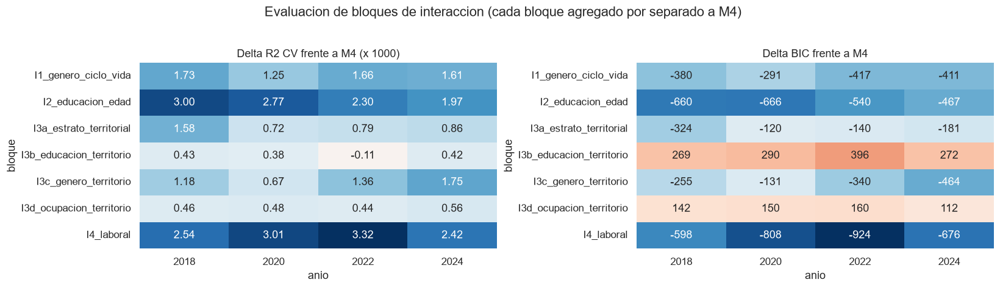

Entraron cinco bloques:
- género × edad, estado conyugal y menores;
- educación × edad;
- región × tamaño de localidad;
- género × territorio;
- subordinación × seguridad social y horas.

Quedaron fuera educación × territorio y ocupación × localidad: son significativas, pero empeoran el BIC.

### 2.13 Controlar por ocupación esconde parte del valor de la escolaridad

*Síntoma.* Al agregar ocupación y sector, la prima de licenciatura cayó de +43% a +27% en 2024.
*Diagnóstico.* La ocupación es en parte **resultado** de la escolaridad: es un "mal control" para la pregunta educativa.
*Solución.* La asociación **total** de la escolaridad se lee en el modelo sin ocupación (M3); el modelo final (M5) se usa para el resto de los determinantes y para medir cuánto de la prima opera a través del tipo de trabajo.

### 2.14 Con interacciones, una beta sola no describe a la población

*Síntoma.* En M5, el coeficiente de "mujer" describe solo a una mujer de 40 años, soltera, sin hijos, en el Centro y en una ciudad grande.
*Solución.* **Efectos promedio contrafactuales** (AME). Para cada persona se predice su ingreso con la característica evaluada y con la de referencia, manteniendo todo lo demás como se observó, y se promedia:

$$\text{AME} = \frac1n\sum_i \big[x_i(c) - x_i(r)\big]'\hat\beta.$$

Como es una combinación lineal de las betas, su intervalo de confianza es exacto.

*Un caso detectado al interpretar.* Comparar "subordinado frente a independiente" cambiando solo la subordinación producía combinaciones imposibles, porque el contrato solo existe para subordinados. Se redefinió como un contraste conjunto de **inserción laboral**: independiente frente a subordinado sin contrato y subordinado con contrato.

### 2.15 Volver a pesos subestimaba el ingreso promedio

*Síntoma.* Transformar la predicción con $e^{\hat y} - 1$ subestima la media observada en 18%–25%: el promedio de una exponencial es mayor que la exponencial del promedio (desigualdad de Jensen).
*Solución.* El factor de Duan, $\hat s = \frac1n\sum e^{\hat u_i}$, **estimado por grupo** (subordinación × tamaño de localidad), deja las predicciones calibradas al 4%–6%. Con un solo factor global la media se sobreestima en 14%–20%, por la mezcla de varianzas de la sección 2.11.

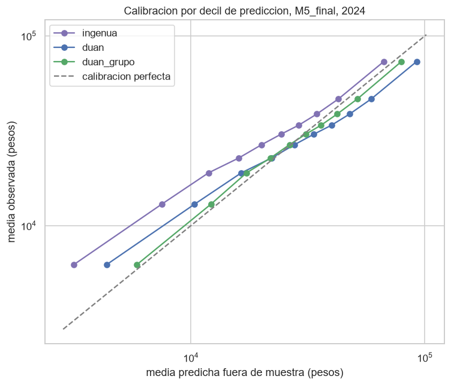

### 2.16 Un modelo multinivel que no convergió

*Síntoma.* El modelo mixto con intercepto aleatorio por entidad (`statsmodels.MixedLM`) no convergió de forma confiable con 140 mil personas.
*Solución.* **Contracción bayesiana empírica** de los 31 efectos estatales (DerSimonian–Laird). Mostró que los efectos estatales son precisos: solo se contraen 1%–3%.

---

## 3. El modelo final y cómo leerlo

$$\ln(1+y_i) = \beta_0 + f(\text{edad}_i) + g(\text{horas}_i) + \text{escolaridad}_i'\gamma + \text{trabajo}_i'\delta + \text{hogar}_i'\eta + \text{territorio}_i'\theta + \text{interacciones}_i'\phi + u_i$$

- $f$: cuadrática en edad.
- $g$: *spline* lineal con nudos en 20, 40, 48 y 60 horas.
- Escolaridad: nivel homologado y grados respecto a la conclusión del nivel.
- Trabajo: inserción laboral, contrato, seguridad social, tamaño de empresa, dos o más trabajos, ocupación y sector.
- Hogar y persona: parentesco, estado conyugal, lengua indígena, autoadscripción, alfabetismo, estrato socioeconómico e integrantes del hogar.
- Territorio: región Banxico y tamaño de localidad.
- Interacciones: los cinco bloques de la sección 2.12.

Se estima por separado para cada año. Las cifras siguientes son **efectos promedio**: la diferencia porcentual promedio en $1+$ingreso frente a la categoría de referencia, con todo lo demás observado. Por ejemplo, "−28%" significa que, con el resto de sus características iguales, las mujeres reciben en promedio un ingreso 28% menor.

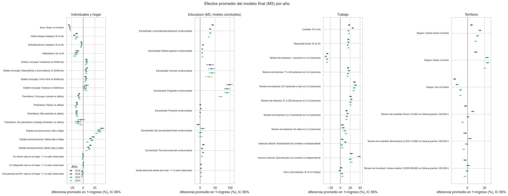

---

## 4. Qué nos dice el modelo

### 4.1 Género: una brecha grande, persistente y más profunda en el campo

- Brecha promedio, mujer frente a hombre comparable: **−31.1% (2018), −28.9%, −29.1%, −28.0% (2024)**. Se redujo 3.1 puntos (significativo con Holm).
- La brecha persiste a lo largo del ciclo de vida: en 2024 va de −26% a −32% entre los 20 y los 70 años, y el perfil de las mujeres es más plano.
- Es **mayor en localidades rurales** (−32% a −39%) que en ciudades grandes (−18% a −27%). Se redujo de forma significativa sobre todo en el **Norte** y en las ciudades medias.

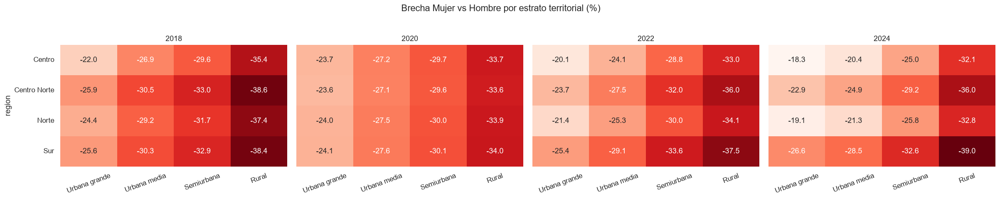

La regresión cuantílica (notebook 15) añade que la brecha es mayor en la parte baja de la distribución (−24% en el percentil 10 frente a −19% en el 90, en 2024).

### 4.2 Ciclo de vida y escolaridad

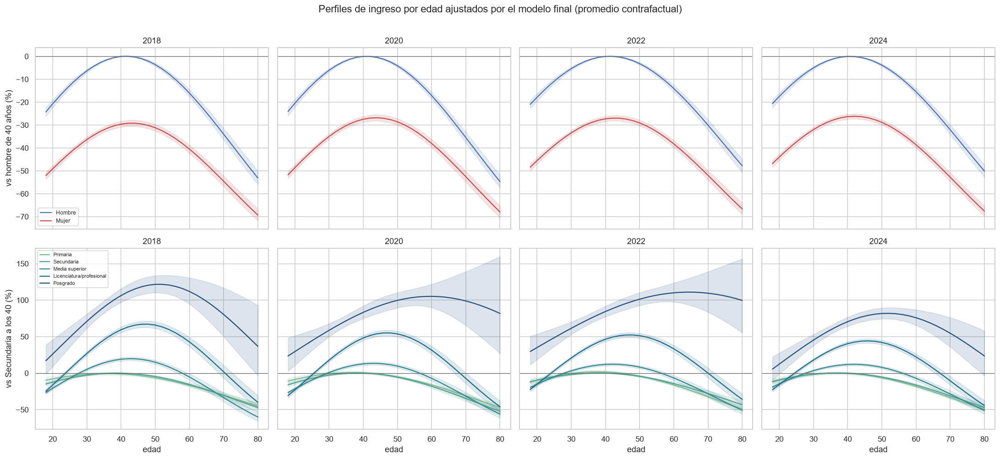

- El ingreso alcanza su máximo alrededor de los **40–44 años**. Un hombre de 20 años recibe 18%–21% menos que uno de 40, y uno de 70, alrededor de un tercio menos.
- **La escolaridad cambia la forma del perfil:** la ventaja de los niveles altos crece con la edad. En 2024, frente a quien concluyó secundaria y tiene la misma edad:

| Nivel | 24 años | 40 años | 60 años |
| --- | --- | --- | --- |
| Licenciatura | +4% | +40% | +46% |
| Posgrado | +34% | +70% | +110% |

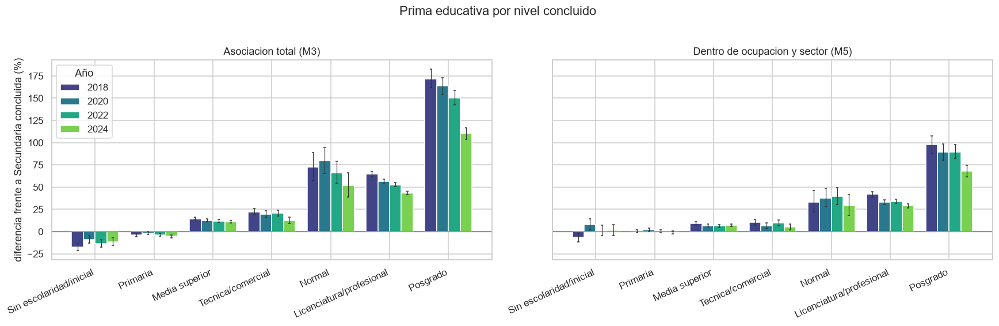

**Compresión de la prima educativa**, asociación total (M3) frente a secundaria concluida:

| Nivel | 2018 | 2020 | 2022 | 2024 | Cambio 2018–2024 |
| --- | --- | --- | --- | --- | --- |
| Media superior | +14.4% | +12.5% | +12.0% | +11.2% | −3.2 pp* |
| Técnica/comercial | +22.2% | +19.8% | +20.6% | +12.6% | −9.6 pp* |
| Licenciatura | +64.7% | +56.5% | +52.7% | +43.4% | −21.2 pp* |
| Posgrado | +171.9% | +163.7% | +150.3% | +110.0% | −61.9 pp* |

\* Significativo con corrección de Holm.

Dentro de la misma ocupación y sector (M5), la prima de licenciatura es menor (+42% → +29%). Esto indica que alrededor de un tercio de la ventaja educativa total opera a través del tipo de trabajo al que da acceso. La regresión cuantílica muestra que la prima educativa es mayor en la parte alta de la distribución (licenciatura +20% en el percentil 10 frente a +37% en el 90, en 2024): la escolaridad se asocia también con más dispersión del ingreso.

### 4.3 Inserción laboral: un mercado segmentado

**Inserción laboral**, frente a trabajar como independiente, entre personas con trabajo principal:

| | 2018 | 2020 | 2022 | 2024 |
| --- | --- | --- | --- | --- |
| Subordinado sin contrato | +3.7% | +10.1% | +2.9% | +3.6% |
| Subordinado con contrato | +22.3% | +37.8% | +20.1% | +21.7% |

Ser asalariado sin contrato apenas se distingue de ser independiente. La ventaja está en el **empleo formal con contrato**, alrededor de +20%. El nivel de 2018 y el de 2024 son prácticamente iguales, pero **2020 sobresale**: la ventaja del empleo con contrato sube a +38% (se rechaza la estabilidad en los cuatro años). Es coherente con que, en el levantamiento de la pandemia, el ingreso de los independientes cayó más que el de los asalariados formales; es una lectura descriptiva, no causal.

- **Seguridad social:** +15% a +16%, estable en los cuatro años.
- **Contrato escrito** (entre subordinados): +17% a +25%.
- **Tamaño de empresa:** gradiente fuerte y estable. Frente a una empresa de 2 a 5 personas, trabajar solo se asocia con −26% a −29%, y una empresa de 251 o más personas con +27% a +31%.
- **Horas:** para los asalariados el ingreso crece hasta unas 48 horas y casi no aumenta después (+10% a +13% con 60–80 horas frente a 40). Para los independientes sigue creciendo (en 2024, +37% con 60 horas y +52% con 80): sus horas se traducen más directamente en ingreso.

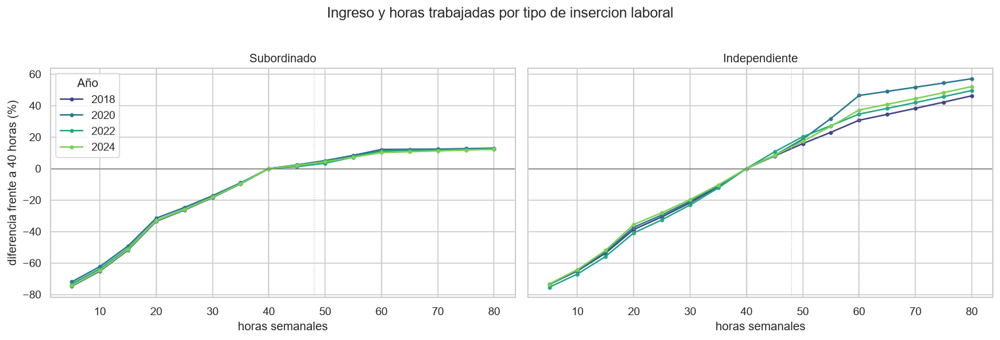

- **Ocupación** (frente a actividades elementales): directivos +62% a +79%, profesionistas +28% a +35% y trabajadores agropecuarios −15% a −26%. Las primas de directivos, profesionistas y auxiliares administrativos **se redujeron** de forma significativa.
- **Sector** (frente a comercio): minería y energía +21% a +32%. Gobierno (+21% → +9%) y educación y salud (+18% → +10%) perdieron ventaja.

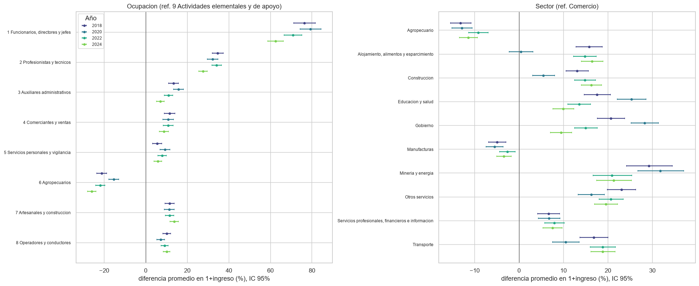

### 4.4 Hogar y condición social

- **Estrato socioeconómico del hogar:** es un diferencial fuerte que se comprime. El estrato alto frente al bajo pasa de +40.8% a +29.0%, y el medio alto de +21.3% a +9.2%; ambos cambios son significativos.
- **Población indígena:**
  - hablar una lengua indígena se asocia con **−14% a −19%**, sin cambio claro en el tiempo;
  - la autoadscripción, sin hablar la lengua, con −3.5% a −4.9%;
  - no saber leer ni escribir, con −13% a −19%.
- **Posición en el hogar:** hijos e hijas frente a la jefatura, −13% a −16%; personas casadas frente a solteras, +6% a +8%. Cada menor adicional en el hogar se asocia con un efecto pequeño (entre 0% y −1.5% en promedio); el bloque género × menores permite que ese efecto difiera por sexo.

### 4.5 Territorio: dónde se gana más, a igualdad de características

**Región y tamaño de localidad.** Con todo lo demás controlado:
- El **Norte** pasó de +9.7% (2018) a **+20.3%** (2024) frente al Centro. El salto ocurre casi por completo entre 2018 y 2020 (a +22.8%) y después se mantiene.
- El **Sur** redujo su desventaja de −14.9% a **−8.2%**.
- Centro Norte pasó de +4.7% a +9.6%.

Los tres cambios son significativos. Una vez controladas ocupación y escolaridad, el tamaño de localidad por sí solo pesa poco (de −6% a +6%), pero se combina con la región: en 2024, el campo del Sur está −21% frente a una ciudad grande del Centro, y el campo del Norte +17%.

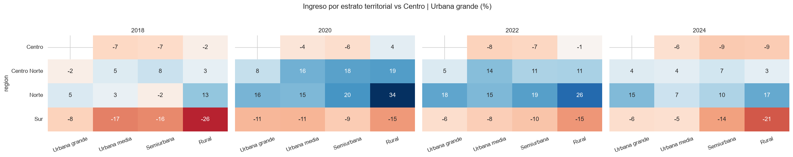

**Entidades** (frente a Ciudad de México, 2024):
- arriba: Baja California +39%, Baja California Sur +27%, Colima +17% y Chihuahua +16%;
- abajo: Guerrero −27%, Chiapas −25%, Tlaxcala −21% y Oaxaca −21%.

Trece de 31 entidades cambiaron de forma significativa entre 2018 y 2024, **todas hacia una posición más favorable frente a la Ciudad de México**. Como la comparación es relativa, esto puede reflejar que esas entidades mejoraron, que la capital perdió ventaja, o ambas cosas.

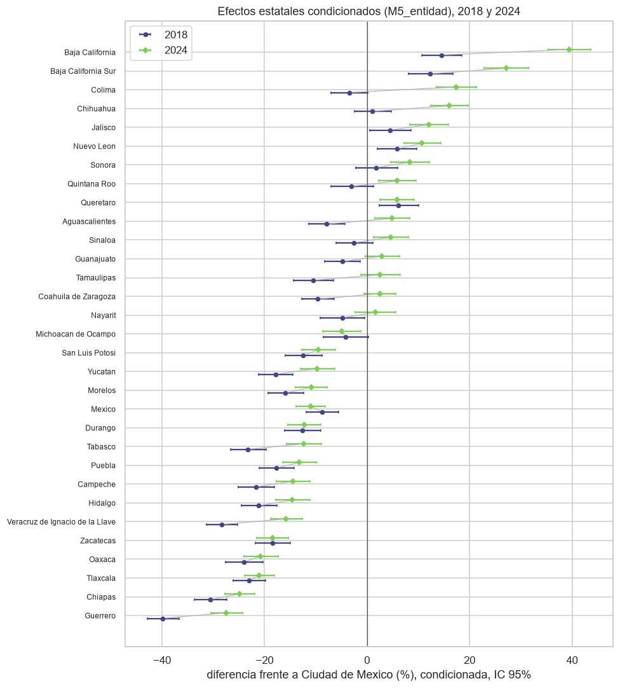

### 4.6 Qué cambió entre 2018 y 2024

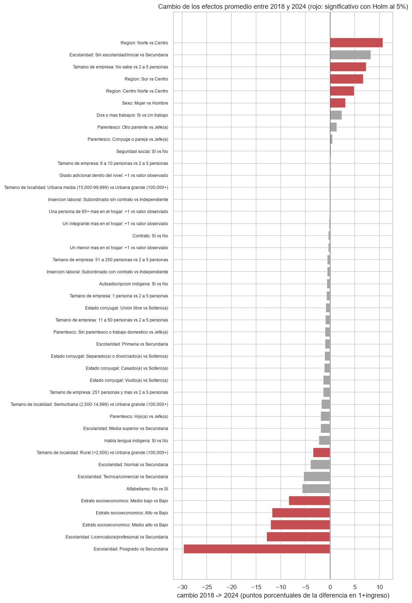

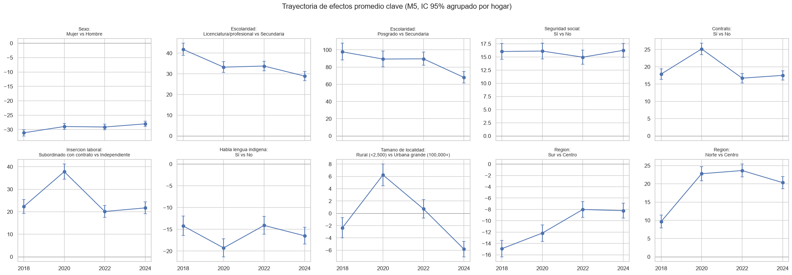

| Se comprimió (significativo con Holm) | Se mantuvo | Se amplió |
| --- | --- | --- |
| Primas educativas (licenciatura, posgrado, técnica, media superior) | Seguridad social (+16%) | Ventaja del Norte |
| Primas de ocupación directiva, profesional y administrativa | Tamaño de empresa | Penalización rural en el Centro |
| Primas de estrato socioeconómico | Lengua indígena | Posición relativa de 13 entidades frente a la CDMX |
| Ventaja del sector gobierno y del de educación y salud | | |
| Desventaja del Sur; brecha de género (levemente) | Forma del perfil de edad (visual, sin prueba formal) | |

**Una hipótesis para discutir.** La compresión simultánea de diferenciales por escolaridad, ocupación, estrato y región es consistente con un aumento del ingreso en la parte baja de la distribución. Entre 2019 y 2024 el salario mínimo tuvo aumentos reales inéditos, y desde enero de 2019 la zona libre de la frontera norte tiene un salario mínimo diferenciado. Esto podría relacionarse con que la ventaja del Norte salte justamente entre 2018 y 2020. El modelo **no** puede atribuir causalidad. Probar esta hipótesis requeriría una estrategia de identificación específica, por ejemplo exposición diferencial al salario mínimo por región, sector u ocupación.

---

## 5. Limitaciones

- **Asociaciones, no causas:** no hay una estrategia de identificación causal; las variables omitidas (habilidad, calidad educativa, experiencia real) pueden sesgar los coeficientes.
- **Selección:** solo se observa a quien tiene ingreso laboral positivo. No se modela la decisión de participar, lo que importa especialmente para la brecha de género.
- **Diseño muestral:** las estimaciones no están ponderadas y los errores agrupados por hogar no reproducen estratos ni UPM.
- **Montos nominales:** los niveles en pesos no se comparan entre años; las brechas porcentuales sí.
- **Homologación:** los años de escolaridad son aproximados (sin antecedente escolar para Normal y Técnica), y ocupación y sector se usan en agregados estables por los cambios de catálogo.
- **Escala:** el logaritmo no es la transformación óptima de Box–Cox ($\hat\lambda \approx 0.22$–$0.25$); queda pendiente una sensibilidad con potencia.
- **Ingresos muy bajos:** dominan la asimetría residual; un modelo de dos partes podría tratarlos mejor.

## 6. Decisiones que conviene revisar juntos

1. ¿Leer la escolaridad con M3 (asociación total) y el resto de los determinantes con M5, como se propone aquí?
2. ¿Presentar asalariados e independientes como ecuaciones separadas en la versión final, dado que mejoran el ajuste y sus determinantes difieren?
3. ¿Incorporar los ponderadores de la ENIGH al menos como sensibilidad, y retomar el diseño muestral formal?
4. ¿Modelar la participación (ingreso positivo o no) para abordar la selección, sobre todo por género?
5. ¿Incluir la hipótesis del salario mínimo como discusión o como una extensión empírica?
6. ¿Adoptar Box–Cox ($\lambda \approx 0.25$) como análisis de sensibilidad de la escala?

## 7. Cómo reproducir

1. **Notebook 05:** construye el mart de personas, incluidos ocupación y sector del trabajo principal.
2. **Notebook 12:** construye una base por año; se ejecuta con `ANIO_ANALISIS` igual a 2018, 2020, 2022 y 2024.
3. **Notebook 15:** especificación y validación (unos 30 minutos). Exporta las bases de modelado a `data/processed/especificacion_validacion/`.
4. **Notebook 16:** interpretación del modelo final (unos 25 minutos).

Todas las figuras de este documento se regeneran al ejecutar los notebooks 15 y 16.
